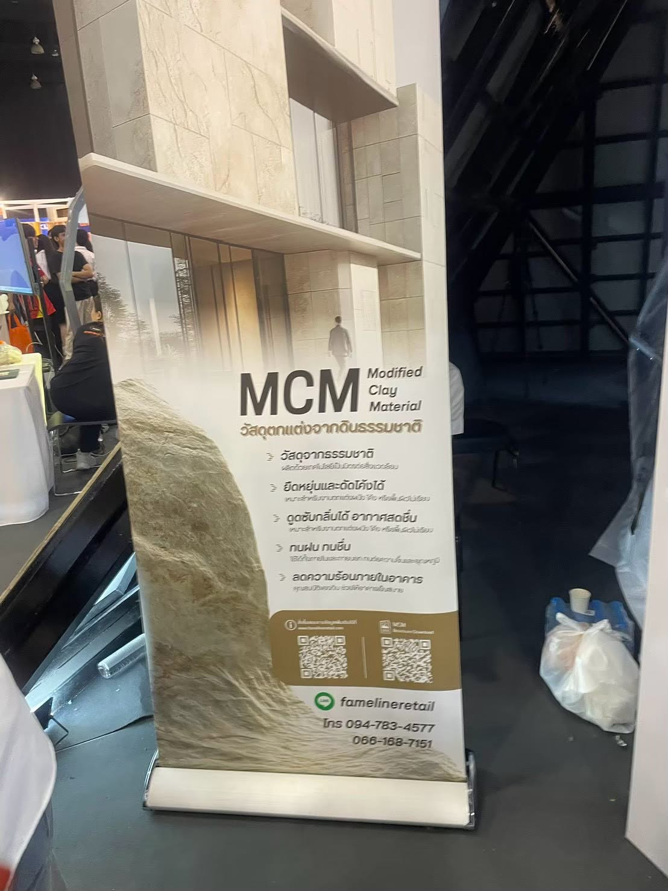
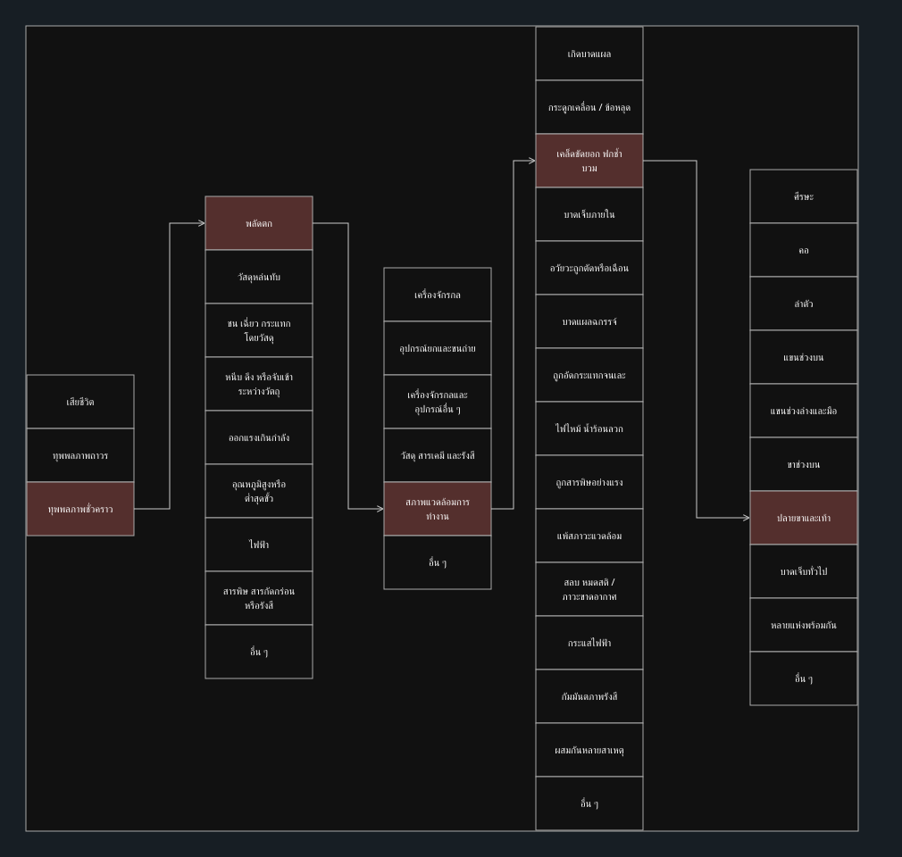
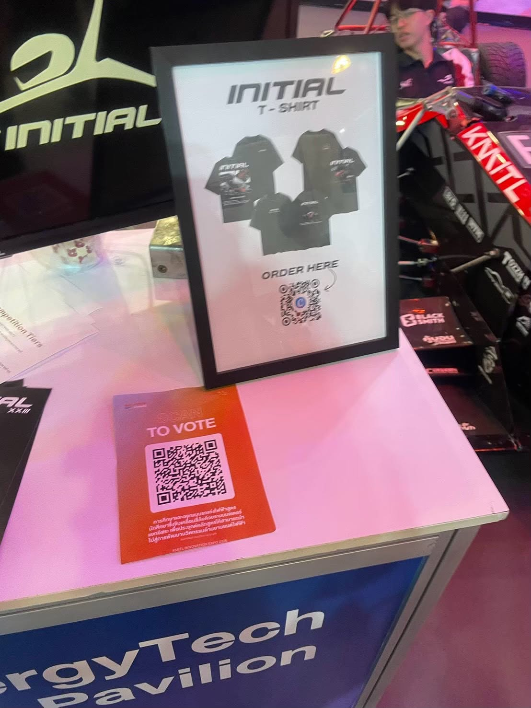
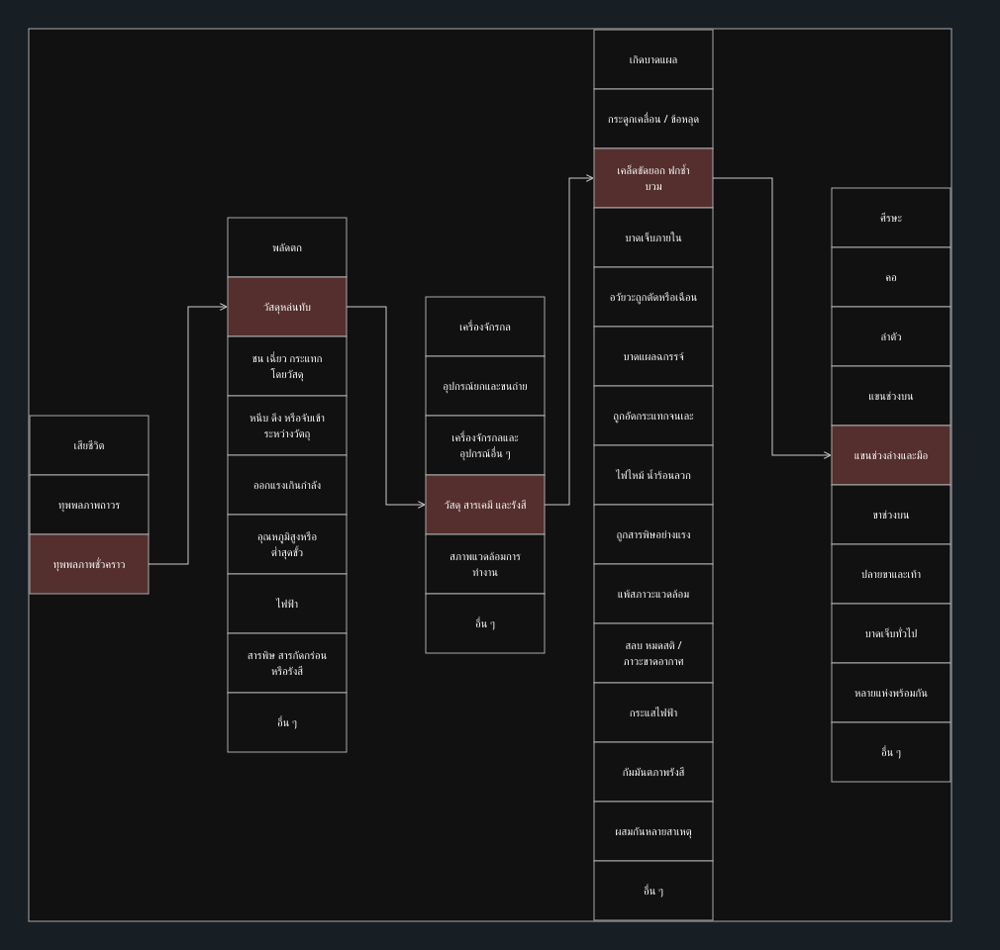
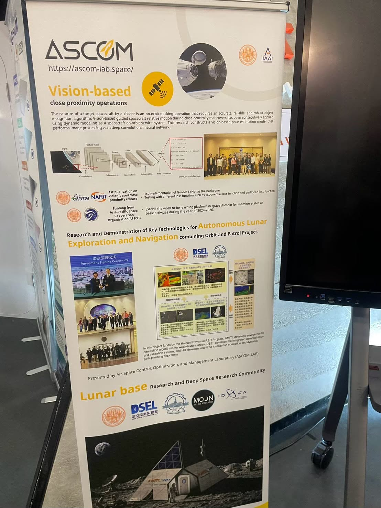
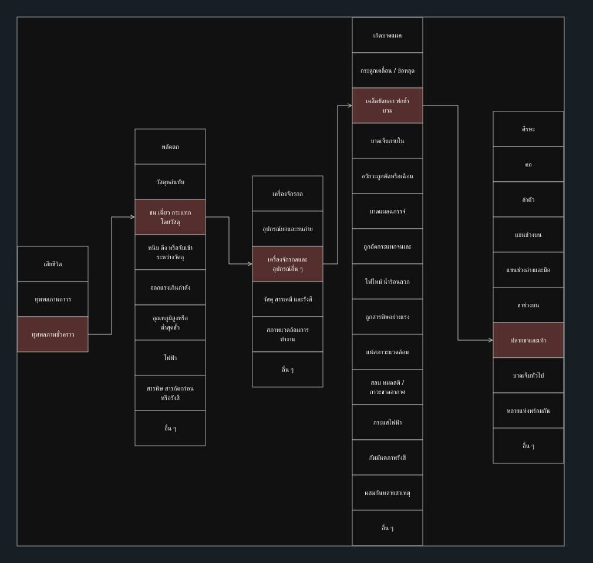

# Week 08 — วิเคราะห์สถานการณ์อันตรายในงาน Expo
นายธนพล หมุนไหม | 69030099

สถานที่ตามข้อมูลผู้ส่งภาพ: หอประชุม งาน Expo

> รายงานนี้เป็นการวิเคราะห์สถานการณ์สมมติจากภาพที่ผู้จัดทำให้มา ไม่ใช่บันทึกอุบัติเหตุจริงหรือข้อยืนยันว่าบูธละเลยความปลอดภัย ชื่อพื้นที่ย่อยยังไม่ทราบ จึงยังยืนยันเงื่อนไข 3 บูธใน 3 พื้นที่ตามโจทย์ไม่ได้ ใช้หัวข้อพื้นที่ด้านล่างเพื่อจัดเนื้อหาเท่านั้น ไม่ใช่ชื่อโซนทางการ

## 1. MCM — วัสดุตกแต่งจากดินธรรมชาติ
พื้นที่วิเคราะห์: จุดจัดแสดง MCM (ชื่อพื้นที่จริงยังไม่ยืนยัน)

**สิ่งที่เห็นจากภาพ:** เห็นป้ายโรลอัปและฐานโลหะตั้งอยู่ใกล้บริเวณสัญจร มีถุงและภาชนะวางอยู่ด้านข้าง

**สถานการณ์สมมติที่อาจเกิด:** สมมติว่าขณะผู้เข้าชมเดินหลบคนหน้าบูธ ปลายเท้าเกี่ยวฐานป้ายที่ยื่นออกมา ทำให้เสียหลักล้มและข้อเท้าขวาพลิก หากต้องหยุดงานหรือหยุดเรียนชั่วคราวแล้วกลับมาใช้ชีวิตปกติ จัดอยู่ในกลุ่มทุพพลภาพชั่วคราว

| มิติ | การจำแนกผลที่อาจเกิดตามสถานการณ์สมมติ |
|---|---|
| ความร้ายแรง | ทุพพลภาพชั่วคราว ภายใต้เงื่อนไขที่สมมติให้พักรักษาและกลับเป็นปกติ |
| ประเภทอุบัติเหตุ | พลัดตก / ลื่นล้ม |
| ตัวการ | สภาพแวดล้อมการทำงาน — สิ่งกีดขวางทางเดิน |
| ลักษณะบาดเจ็บ | เคล็ดขัดยอก ฟกช้ำ บวม |
| ตำแหน่งบาดเจ็บ | ปลายขาและเท้า — ข้อเท้าขวา |

**Unsafe Act:** เดินถอยหรือเบี่ยงตัวโดยไม่เห็นพื้นด้านหลัง (สมมติ)

**Unsafe Condition:** ฐานป้ายยื่นเข้าแนวเดินและมีของวางใกล้ทางสัญจร (เงื่อนไขสมมติที่ต้องตรวจหน้างาน)

**การป้องกัน:** ย้ายฐานป้ายให้อยู่ภายในแนวบูธ เก็บของด้านข้างให้พ้นทางเดิน ใช้ฐานที่ไม่ยื่นเป็นจุดสะดุด และตรวจเส้นทางสัญจรก่อนเปิดงาน

[ดาวน์โหลดแผนภาพแก้ไขใน diagrams.net](diagrams/mcm.drawio)

## 2. INITIAL — บูธรถและประชาสัมพันธ์ผลงาน
พื้นที่วิเคราะห์: จุดจัดแสดง INITIAL (ชื่อพื้นที่จริงยังไม่ยืนยัน)

**สิ่งที่เห็นจากภาพ:** เห็นกรอบป้ายตั้งบนโต๊ะ และรถจัดแสดงอยู่ใกล้กัน ภาพไม่แสดงวิธียึดกรอบป้าย

**สถานการณ์สมมติที่อาจเกิด:** สมมติว่าขณะผู้เข้าชมโน้มตัวสแกน QR Code แขนไปชนกรอบป้ายที่ไม่ได้ยึดกับโต๊ะ ป้ายล้มกระแทกหลังมือซ้ายจนฟกช้ำบวม หากอาการต้องพักรักษาชั่วคราวและหายเป็นปกติ ให้จำแนกเป็นทุพพลภาพชั่วคราว ไม่ใช่อวัยวะถูกตัด

| มิติ | การจำแนกผลที่อาจเกิดตามสถานการณ์สมมติ |
|---|---|
| ความร้ายแรง | ทุพพลภาพชั่วคราว ภายใต้เงื่อนไขที่สมมติให้พักรักษาและกลับเป็นปกติ |
| ประเภทอุบัติเหตุ | วัสดุหล่นทับ — กรอบป้ายล้มลงกระแทกมือ |
| ตัวการ | วัสดุ สารเคมี และรังสี — กรอบป้ายเป็นวัตถุที่กระแทกโดยตรง |
| ลักษณะบาดเจ็บ | เคล็ดขัดยอก ฟกช้ำ บวม |
| ตำแหน่งบาดเจ็บ | แขนช่วงล่างและมือ — หลังมือซ้าย |

**Unsafe Act:** เอื้อมแขนผ่านป้ายจนชนกรอบ (สมมติ)

**Unsafe Condition:** กรอบตั้งไม่มั่นคงหรือไม่ได้ยึด (สมมติ ภาพยังยืนยันไม่ได้)

**การป้องกัน:** ยึดกรอบป้ายให้มั่นคงหรือใช้ป้ายแบนติดโต๊ะ จัดจุดสแกน QR ให้เข้าถึงโดยไม่เอื้อมผ่านวัตถุ และเว้นระยะผู้ชมจากรถจัดแสดง

[ดาวน์โหลดแผนภาพแก้ไขใน diagrams.net](diagrams/initial.drawio)

## 3. ASCOM — งานวิจัยด้านอวกาศและระบบควบคุม
พื้นที่วิเคราะห์: จุดจัดแสดง ASCOM (ชื่อพื้นที่จริงยังไม่ยืนยัน)

**สิ่งที่เห็นจากภาพ:** เห็นป้ายโรลอัปข้างจอแสดงผลบนขาตั้งมีล้อ โดยขาตั้งอยู่บริเวณพื้นใกล้ป้าย ภาพไม่บอกว่าล้อล็อกอยู่หรือไม่

**สถานการณ์สมมติที่อาจเกิด:** สมมติว่าล้อขาตั้งจอไม่ได้ล็อก เมื่อมีผู้ชมเบียดขาตั้ง จอเคลื่อนและฐานล้อชนหน้าแข้งขวาของผู้ชมที่ยืนอ่านป้าย ทำให้ฟกช้ำบวม หากต้องพักรักษาชั่วคราวและหายปกติ ให้จัดเป็นทุพพลภาพชั่วคราว เหตุการณ์นี้ไม่ได้สมมติว่าจอล้มทับ

| มิติ | การจำแนกผลที่อาจเกิดตามสถานการณ์สมมติ |
|---|---|
| ความร้ายแรง | ทุพพลภาพชั่วคราว ภายใต้เงื่อนไขที่สมมติให้พักรักษาและกลับเป็นปกติ |
| ประเภทอุบัติเหตุ | ชน เฉี่ยว กระแทก โดยวัสดุ |
| ตัวการ | เครื่องจักรกลและอุปกรณ์อื่น ๆ — ขาตั้งจอแสดงผล |
| ลักษณะบาดเจ็บ | เคล็ดขัดยอก ฟกช้ำ บวม |
| ตำแหน่งบาดเจ็บ | ปลายขาและเท้า — หน้าแข้งขวา |

**Unsafe Act:** เบียดหรือพิงขาตั้งขณะเดินชม (สมมติ)

**Unsafe Condition:** ล้อไม่ได้ล็อกและฐานตั้งอยู่ชิดแนวเดิน (สมมติ ภาพไม่ยืนยันการล็อกล้อ)

**การป้องกัน:** ล็อกล้อและตรวจความมั่นคงของขาตั้ง ย้ายฐานให้พ้นแนวเดิน กำหนดพื้นที่ยืนชม และให้เจ้าหน้าที่ควบคุมก่อนเคลื่อนย้ายจอ

[ดาวน์โหลดแผนภาพแก้ไขใน diagrams.net](diagrams/ascom.drawio)

## ข้อสรุป
ความเสี่ยงจากการจัดวางอุปกรณ์เกิดขึ้นได้แม้บูธไม่ได้สาธิตเครื่องจักรอันตราย ควรตรวจความมั่นคงของป้ายและจอ เก็บฐานหรือสิ่งของออกจากทางเดิน และจัดระยะยืนชมให้เหมาะสม ภาพถ่ายเพียงมุมเดียวไม่สามารถยืนยันความมั่นคง น้ำหนัก การล็อกล้อ หรือระบบป้องกันทั้งหมดได้ จึงควรตรวจหน้างานก่อนสรุปผลจริง

แผนภาพใช้หมวดตามเอกสาร Week 07 ของ [koson/OHS_2569](https://github.com/koson/OHS_2569/tree/main/Week-07) ช่องสีแดงหม่นคือผลสมมติที่เลือก ลูกศรเชื่อมการจำแนกเหตุการณ์เดียวกัน ไม่ใช่ลำดับสาเหตุ จัดทำด้วยความช่วยเหลือจาก AI ตามภาพและขอบเขตที่ผู้จัดทำกำหนด
