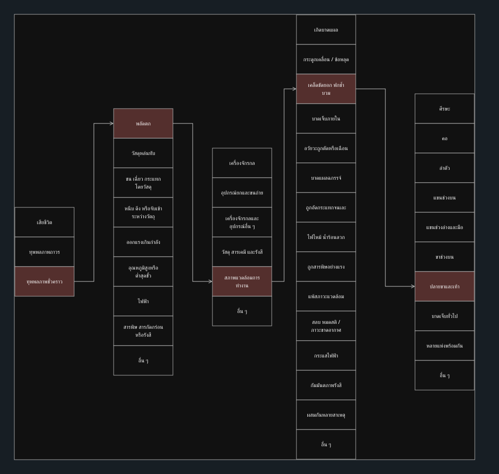

# Week 07 — อุบัติเหตุลื่นล้มในคลังสินค้า
**นายธนพล หมุนไหม | รหัสนักศึกษา 69030099**

> สถานการณ์สมมติจากการทำงาน จัดทำเพื่อฝึกจำแนกอุบัติเหตุด้วยความช่วยเหลือจาก AI ไม่ใช่ประสบการณ์จริงหรือรายงานผู้บาดเจ็บจริง

## สถานการณ์
ช่วงเช้าของวันทำงาน “อนันต์” พนักงานคลังสินค้าได้รับมอบหมายให้นำกล่องอะไหล่จากชั้นวางไปยังโต๊ะตรวจรับสินค้า ก่อนหน้านั้นพนักงานทำความสะอาดได้ถูพื้นทางเดิน แต่ยังมีน้ำตกค้าง โดยไม่ได้กั้นพื้นที่หรือวางป้ายเตือน และยังเปิดให้พนักงานเดินผ่านตามปกติ

อนันต์รีบขนกล่องสองใบซ้อนกันเพื่อให้ทันรอบส่งสินค้า กล่องบังสายตาบริเวณพื้นด้านหน้า เขาจึงไม่เห็นจุดเปียก เมื่อก้าวผ่านบริเวณดังกล่าว เท้าขวาลื่นไถลและข้อเท้าพลิก ก่อนเสียหลักล้มลงบนพื้น กล่องตกลงด้านข้างโดยไม่กระแทกตัวเขาหรือผู้อื่น

เพื่อนร่วมงานแจ้งหัวหน้างานและประสานนำอนันต์ไปรับการรักษา ในสถานการณ์สมมตินี้ ผลการตรวจระบุว่าข้อเท้าขวาแพลง มีอาการบวม แต่ไม่มีกระดูกหักและไม่มีการบาดเจ็บที่อวัยวะอื่น อนันต์หยุดงาน 14 วัน หลังรักษาและพักฟื้นสามารถกลับมาทำงานเดิมได้ตามปกติ โดยไม่มีความพิการถาวร

## การจำแนกอุบัติเหตุ 5 ด้าน
ใช้ชื่อหมวดตามเอกสารรายวิชา Week07-01 ถึง Week07-05 ตัวเลขหมวดในตารางเป็นลำดับในเอกสารเรียน ไม่ใช่รหัสสถิติสากลที่ตรวจสอบแยกต่างหาก

| ด้าน | หมวดที่เลือก | หลักฐานจากสถานการณ์ |
|---|---|---|
| ความร้ายแรง (Severity) | ทุพพลภาพชั่วคราว | หยุดงาน 14 วัน แล้วกลับมาทำงานเดิมได้ ไม่มีความพิการถาวร |
| ประเภทอุบัติเหตุ (Type) | หมวด 1 การพลัดตกของคนงาน — ลื่นล้มระดับเดียวกัน | เท้าลื่นและเสียหลักล้มบนพื้น ไม่ได้ตกจากที่สูง |
| ตัวการ (Agency) | หมวด 5 สภาพแวดล้อมในการทำงาน | พื้นทางเดินเปียกเป็นสภาพอันตรายหลัก กล่องที่ถือบังสายตาเป็นปัจจัยร่วม |
| ลักษณะบาดเจ็บ (Nature) | หมวด 3 เคล็ดขัดยอก ฟกช้ำ บวม | ข้อเท้าขวาแพลงและบวม โดยไม่ได้ระบุว่ากระดูกหัก |
| ตำแหน่งบาดเจ็บ (Location) | หมวด 7 ปลายขาและเท้า — ข้อเท้าขวา | บาดเจ็บเฉพาะข้อเท้าขวา จึงไม่เลือกหลายแห่งพร้อมกัน |

ลูกศรในภาพเชื่อมหมวดที่เลือกสำหรับเหตุการณ์เดียวกัน ไม่ได้หมายความว่าความร้ายแรงเป็นสาเหตุของอุบัติเหตุ

## วิเคราะห์สาเหตุ
**การกระทำที่ไม่ปลอดภัย (Unsafe Act):** รีบเดินและถือกล่องซ้อนจนบังแนวทางเดินด้านหน้า ทำให้สังเกตพื้นเปียกได้ยาก

**สภาพการณ์ที่ไม่ปลอดภัย (Unsafe Condition):** พื้นมีน้ำตกค้าง ไม่กั้นพื้นที่ และไม่มีป้ายแจ้งเตือนขณะพื้นยังไม่แห้ง

**ประเด็นเชิงระบบ:** ในกรณีนี้มีการเปิดทางเดินหลังทำความสะอาดทั้งที่พื้นยังเปียก จึงควรกำหนดผู้ตรวจรับพื้นที่ก่อนเปิดใช้งาน ส่วนแรงกดดันจากรอบส่งสินค้าและความเหมาะสมของอุปกรณ์ขนย้ายเป็นประเด็นที่ควรตรวจเพิ่มเติม หากเป็นการสอบสวนจริง ไม่ควรสรุปว่าเกิดจากความประมาทของอนันต์เพียงคนเดียว

## มาตรการป้องกันที่เสนอ
| ลำดับ | มาตรการ | ผู้รับผิดชอบที่เสนอ | วิธีตรวจผล |
|---|---|---|---|
| 1 | กำจัดน้ำตกค้างและตรวจว่าพื้นแห้งก่อนเปิดทางเดิน หากมีน้ำรั่วให้แก้ต้นเหตุ | ผู้ดูแลอาคารและทีมทำความสะอาด | ตรวจพื้นที่ก่อนส่งมอบทุกครั้ง |
| 2 | ปรับวิธีทำความสะอาดให้พื้นเปียกน้อยลง และพิจารณาพื้นผิวที่เหมาะกับการป้องกันการลื่น | ผู้ดูแลอาคาร | ทดลองและประเมินสภาพทางเดินหลังทำความสะอาด |
| 3 | ใช้แนวกั้นแยกคนออกจากพื้นที่เปียก จัดทางเลี่ยง และติดป้ายเตือนที่มองเห็นได้ | ทีมทำความสะอาดและหัวหน้างาน | ไม่เปิดแนวกั้นจนผู้รับผิดชอบตรวจว่าพร้อมใช้งาน |
| 4 | ใช้รถเข็นที่เหมาะสม ลดจำนวนกล่องที่ถือ และจัดงานให้มองเห็นทางเดินได้ตลอด | หัวหน้าคลังและพนักงาน | สังเกตวิธีขนย้ายและตรวจว่าทางเดินไม่ถูกกีดขวาง |
| 5 | เลือกรองเท้าทำงานที่เหมาะกับสภาพพื้น ตรวจสภาพพื้นรองเท้า และไม่ใช้รองเท้าเป็นมาตรการเดียว | หัวหน้างานและพนักงาน | ตรวจความเหมาะสมและการสึกหรอก่อนใช้งาน |
| 6 | เปิดช่องทางแจ้งพื้นเปียกและเหตุเกือบล้ม พร้อมแจ้งผลการแก้ไขให้ผู้รายงานทราบ | หัวหน้าคลัง | ติดตามเวลาปิดงานแก้ไขและเหตุซ้ำที่จุดเดิม |

มาตรการทั้งหมดเป็นข้อเสนอสำหรับกรณีสมมติ ยังไม่ได้อ้างว่ามีการนำไปใช้จริง

## ข้อคิดจากเหตุการณ์
การหยุดงานชั่วคราวยังส่งผลต่อผู้บาดเจ็บและการจัดกำลังคนของคลังสินค้า การป้องกันควรเริ่มจากทำให้พื้นปลอดภัย แยกพื้นที่ระหว่างทำความสะอาด และออกแบบวิธีขนของให้มองเห็นทางเดิน แทนการบอกให้พนักงานระวังเพียงอย่างเดียว

## ไฟล์แผนภาพ
- [07-1.drawio](07-1.drawio) — ไฟล์แก้ไขได้ เปิดใน [diagrams.net](https://app.diagrams.net/) ผ่าน **File → Open from → Device** หลังดาวน์โหลดไฟล์
- [07-1.svg](07-1.svg) — ภาพสำหรับอ่านบน GitHub และนำไปประกอบงาน

## อ้างอิงและขอบเขต
- [Week07-01 ความร้ายแรง](https://github.com/koson/OHS_2569/blob/main/Week-07/Week07-01.md)
- [Week07-02 ประเภทอุบัติเหตุ](https://github.com/koson/OHS_2569/blob/main/Week-07/Week07-02.md)
- [Week07-03 ตัวการ](https://github.com/koson/OHS_2569/blob/main/Week-07/Week07-03.md)
- [Week07-04 ลักษณะบาดเจ็บ](https://github.com/koson/OHS_2569/blob/main/Week-07/Week07-04.md)
- [Week07-05 ตำแหน่งบาดเจ็บ](https://github.com/koson/OHS_2569/blob/main/Week-07/Week07-05.md)

เอกสาร [Week07-06](https://github.com/koson/OHS_2569/blob/main/Week-07/Week07-06.md) ระบุให้เล่าประสบการณ์จริงและนำเสนอหน้าชั้น ชิ้นนี้ใช้สถานการณ์สมมติตามที่ผู้จัดทำขอ จึงไม่ใช่หลักฐานว่าได้ทำกิจกรรมประสบการณ์จริงหรือนำเสนอแล้ว
